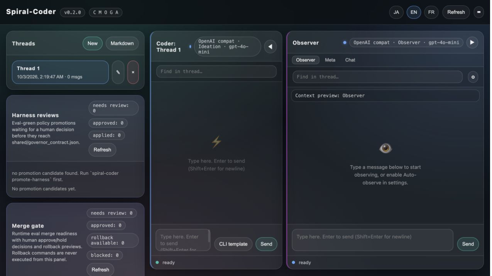

# Spiral-Coder

**Code, check, and keep going—with Coder + Observer.**

Bring a failing test, a small bug, or a refactor. Coder reads and edits your
project; Observer reviews the work in a separate context and can feed the next
step back. Chat is there when you want to think through the design together.

[English](README.md) · [日本語](README.ja.md) · [Français](README.fr.md)

[](https://www.npmjs.com/package/spiral-coder)
[](LICENSE)

## Start in your project

Requires **Node.js 20+** and a provider API key. The npm package includes the
native runtime, so you do not need Rust installed.

```sh
npm install -g spiral-coder@latest
cd your-project
export GEMINI_API_KEY="your-key"
spiral --provider gemini
```

This example uses macOS/Linux shell syntax. [Get started](docs/getting-started.md)
includes PowerShell, OpenAI and Mistral setup. Choose `/provider` and `/model`
in the TUI to save your project preferences; then launch with just `spiral`.
Use a model available to your account and `/keys` to check setup.

Supports macOS Apple Silicon/Intel, Linux arm64/x64 (glibc 2.35+) and Windows x64.
[Install help, updates and other platforms →](docs/npm-distribution.md)

## Give it a real, small task

Try one of these in the **Coder** pane:

> Reproduce the failing test, fix the smallest relevant part of the source,
> and run the tests again. Explain what changed and what remains unverified.

> Read @src/main.rs and explain the request flow. Suggest one focused refactor
> before making changes.

> Add an empty-input case to this parser, keep its public API stable,
> and verify the existing tests still pass.

Use your project's paths and test command. Start with a task whose result you
can inspect, then build on it.

## Keep the work and its review together

- **Coder + Observer are one working loop.** Coder executes; Observer critiques
  recorded output and proposes the next step. Press `Ctrl+O` for a review, or
  enable `/autofix` to forward Observer suggestions back to Coder.
- **Choose your models.** Use OpenAI, Gemini or Mistral for coding. Coder and
  Observer share the selected model by default; separate role settings are
  available when you want a different pairing.
- **Pick up where you left off.** Keep sessions, inspect tool results and diffs,
  and continue with the next concrete change.
- **Make room to think.** Switch to Chat for design discussion while keeping
  the coding work in view.

A review is another source of feedback; verify the resulting diff and checks.

| In the TUI | Action |
| --- | --- |
| `/model` · `/provider` | Choose a model or provider |
| `Ctrl+O` | Ask Observer to review the latest completed Coder response |
| `/autofix` | Toggle Observer → Coder follow-up |
| `Ctrl+K` | Stop the focused stream |
| `/lang ja` · `/lang en` · `/lang fr` | Change the UI language |
| `/help` | See all commands |

TUI tool actions run automatically. For approval prompts before commands and
file edits, use the [headless CLI](docs/usage.md#headless-coding-and-resume).

## Prefer a browser?

```sh
spiral serve
```

Open **http://127.0.0.1:8080/** and choose your project folder, provider and model
in Settings. Coder, Observer and Chat are available in the local Web UI.



*Local capture of the 0.2.0 Web UI; no model request was made for this image.*

## Go further

- [Getting started](docs/getting-started.md) — keys, your first task and first review.
- [Usage guide](docs/usage.md) — sessions, CLI, Web settings and project configuration.
- [Documentation](docs/README.md) — find the guide you need.
- [Research & development](docs/research/README.md) — architecture, evaluations,
  self-dogfooding and experimental results.
- [Build from source / contribute](docs/usage.md#build-and-contribute) — work on
  the current development branch.
- [Migrating from Observistral](docs/migration-spiral-coder.md) — commands and existing data.

[Apache License 2.0](LICENSE)
